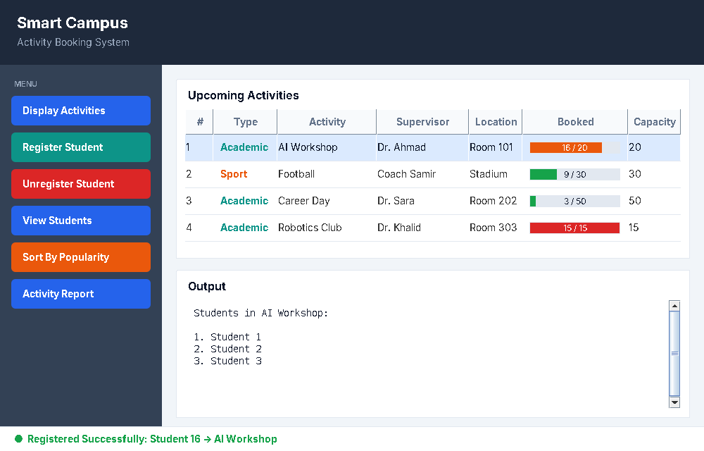

# Smart Campus Activity Booking System

A Java application that lets students browse upcoming campus activities, see how many seats are booked, and register or unregister — built **three times**, once in each programming paradigm, to compare how the same problem looks in each style.



## Features

- Display all activities with booked / capacity counts
- Register and unregister students (with full-capacity check)
- View the students registered in an activity
- Sort activities by popularity using **Selection Sort**
- Activity report with the number of students and how full each activity is

## Three paradigms, one problem

| Version | File | Interface | How data is stored |
|---|---|---|---|
| Procedural | `ProceduralMain.java` | Console menu | Parallel arrays (`activities[]`, `capacity[]`, `booked[]`) |
| Object-Oriented | `OOPMain.java` + `Activity`, `AcademicActivity`, `SportActivity` | Console menu | `ArrayList<Activity>` with inheritance & polymorphism |
| Event-Driven | `EventDrivenMain.java` | Java Swing GUI | Same classes as OOP; each button has its own `ActionListener` |

### What I noticed comparing them

- **Procedural:** quick to write, but sorting meant swapping four arrays in sync — easy to break when adding a new field.
- **OOP:** each activity keeps its own data and behaviour, so sorting swaps one object. Adding a new activity type is just a new subclass.
- **Event-Driven:** the program no longer runs top-to-bottom; it waits for clicks. The challenge is keeping the shared `activities` list consistent across many listeners.

## Project structure

```
src/smartcampus/
├── Activity.java           # base class
├── AcademicActivity.java   # instructor + room
├── SportActivity.java      # coach + location
├── ProceduralMain.java     # procedural version
├── OOPMain.java            # object-oriented version
└── EventDrivenMain.java    # Swing GUI version
```

## How to run

Requires Java 8 or newer.

```bash
javac -d out src/smartcampus/*.java

java -cp out smartcampus.ProceduralMain
java -cp out smartcampus.OOPMain
java -cp out smartcampus.EventDrivenMain
```

Or open the project in Eclipse / IntelliJ and run any of the three `Main` classes.
